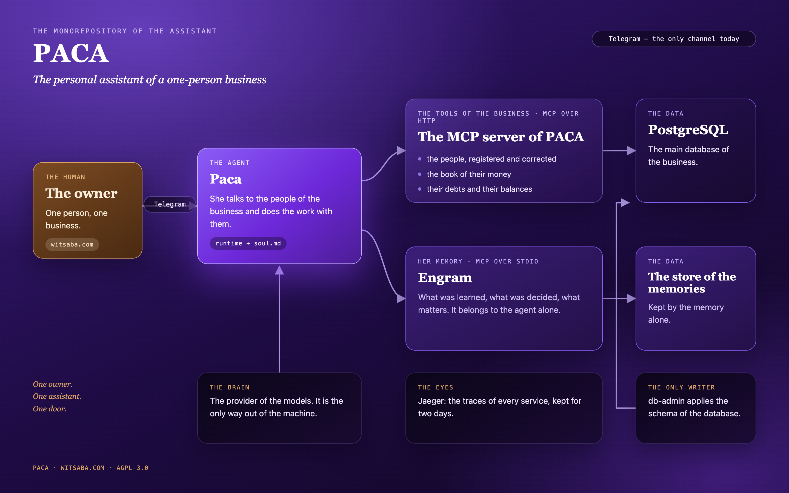

# PACA

**PACA is a personal assistant for a one-person business.** It is the software
behind an assistant called **Paca**: she knows the people of the business, keeps
their book of money, answers them where they already talk, and remembers what
happened yesterday.

One owner, one business, one assistant. No teams, no seats, no dashboard to
learn. Everything runs on your own machine, and nothing leaves it unless you
decide so.

## How it fits together



The source of the picture is [`design/paca-architecture/`](design/paca-architecture/):
it is plain HTML, and any headless browser renders it.

Five pieces, each with one job:

| Piece | What it is |
|-------|------------|
| **Paca** | The agent. She is the interface: a person talks to her, she acts. Her identity lives in one file, [`hermes/soul.md`](hermes/soul.md). |
| **The MCP server of PACA** | The custom tools of the business, written in this repository: the people, their book of money and their debts. The agent never touches the database itself, it asks for tools. |
| **Engram** | The memory of Paca, and it is hers alone: what was learned, what was decided, what matters. It is an MCP server too, so the agent reads and writes it like any other tool. |
| **PostgreSQL** | The main database. The business data lives here. |
| **Jaeger** | The traces. Every request of every service can be followed. |

The MCP server of PACA and Engram are the two doors of the agent: everything it
knows about the business comes through the first, everything it remembers
through the second.

## What exists today

**Telegram is the only channel.** One bot, one allowlist, the owner of the
business and the people she serves. There is no web app, no dashboard, no
Discord, no Slack and no multi-user support yet — and that is a decision, not
an accident: a one-person business needs one good door, not five.

Everything runs with Docker Compose. The stacks are private by default: the
services talk to each other on an internal network that has no outbound access,
and only the agent reaches the outside world, to reach the provider of the
models.

## Running it

```sh
make env-init     # write the configuration (it asks for your keys)
make stack-up     # bring the whole thing up, healthy
make stack-down   # stop it
```

The installer asks for the credentials of the database, the key of the model
provider and the token of the Telegram bot. The `.env` files are never
committed, and the secrets are never printed.

## License

PACA is free software under the **GNU Affero General Public License, version 3
or later** ([LICENSE](LICENSE)).

The AGPL is chosen on purpose: it is a real open source license, and it also
closes the door on the one thing an open source license can still let happen —
someone runs this as a private service and keeps it private. If you run a
modified PACA and let other people use it over a network, you have to offer
them the source of what you are running.

If your use of PACA is private and stays private, the AGPL asks nothing of
you.

## Built with Gentle Shell

PACA was built with [Gentle Shell](https://github.com/Gentleman-Programming/gentle-shell)
(the **gentle-shell™** and **gentle-pi™** names and their logos are trademarks
of Alan Buscaglia) and with [Engram](https://github.com/Gentleman-Programming/engram)
for the memory (the **Engram™** name and its logos are trademarks of the same
owner). Both are used nominatively here: PACA is a project built with them, and
it is not affiliated with, endorsed by, or sponsored by them.

---

## For developers

Everything below is for the people who build on PACA. The public face of the
project is short on purpose; the engineering detail lives where it belongs,
next to the code it describes.

| Where | What it holds |
|-------|---------------|
| [`AGENTS.md`](AGENTS.md) | The architecture contract: the layers, the direction of the dependencies, the ownership of the rules and the checks of SOLID. The canonical entry point for any agent or engineer. |
| [`apps/mcp-server/README.md`](apps/mcp-server/README.md) | The MCP server: the custom tools of the business, the layers of the service and the pool of the database. |
| [`apps/db-admin/README.md`](apps/db-admin/README.md) | The database admin: the single writer of the schema and the migrations it applies. |
| [`packages/domain/README.md`](packages/domain/README.md) | The domain: the models of the people, the book and its accounts, and the rules they carry. Imports nothing but the standard library. |
| [`packages/database/README.md`](packages/database/README.md) | The database library: the pool, the queries, the migrations and the repositories. |
| [`packages/platform/README.md`](packages/platform/README.md) | The platform: the clock, the logs, the telemetry, the HTTP server and the health check that every service shares. |
| [`packages/health/README.md`](packages/health/README.md) | The health: the use case that reports it and the endpoint that answers it. |
| [`hermes/README.md`](hermes/README.md) | The agent: the stack of Paca, the Telegram channel, the provider of the models and the memory she mounts. |
| [`engram/README.md`](engram/README.md) | The memory: the stack of Engram, the payload it publishes and the volume the agent mounts. |
| [`db/postgres/README.md`](db/postgres/README.md) | The database stack: PostgreSQL with pgvector. |
| [`observability/README.md`](observability/README.md) | The traces: the collector and the backend that keeps them. |
| [`odd/tasks/`](odd/tasks/) | The feature documents: the specification of every piece of work, with the decisions and the evidence. |

### The gate

One command proves the repository, from nothing:

```sh
make all
```

It runs the format check, the analyzers, the linter, the build, the tests, the
race detector, the coverage floor and the vulnerability scan of every module,
then the container tests, then the whole stack: it comes up, the schema is
asserted, and it goes down. A step that fails stops the gate, and the exit
code says so.

The gate proves the architecture too: the domain names no technology, the
application knows no adapter, the adapters know no use case, and only the
composition root knows the adapters. Those are assertions that fail, not
comments a reviewer has to remember.
