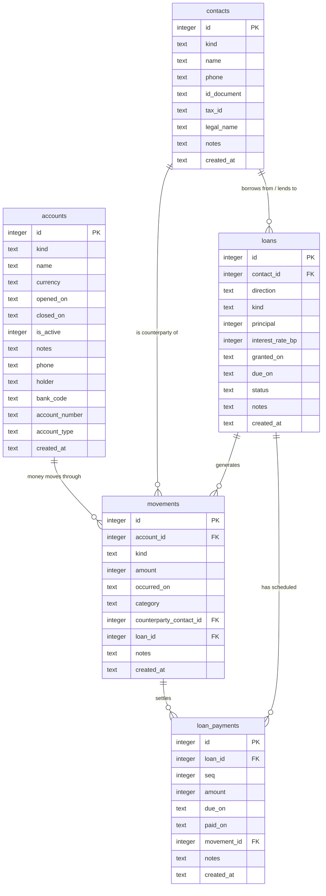

# PACA — Database Reference

PACA is a personal finance manager for the Colombian market, storing all data in SQLite.
This document is the complete reference for the data team: it is sufficient to work with the
database without reading the SQL. Every column, constraint, index, and rule described here is
taken directly from `packages/db/migrations/001_initial_schema.sql`.

The application that will read and write this schema is under construction. Its command
line entry point is [`apps/cli`](apps/cli/README.md); the decisions behind it are recorded
in [`docs/architecture/backend-scaffold.md`](docs/architecture/backend-scaffold.md).

---

## Repository Layout

```
paca/
├── apps/            the runnable applications
│   ├── cli/         the paca command — a Go module, hexagonal, command header only
│   │   ├── cmd/paca/            the composition root
│   │   └── internal/            the hexagonal layers: domain, ports, application, adapters
│   └── README.md
├── docs/            long-form documentation
│   ├── architecture/
│   │   └── backend-scaffold.md  the backend decision record
│   └── README.md
├── odd/             ODD feature documents: specs, tasks, evidence, decision log
│   └── tasks/
│       ├── backend-scaffold.md  feature document: the Go backend scaffold
│       └── database-model.md   feature document: design rationale, benchmarks, tradeoffs
├── packages/
│   └── db/
│       ├── migrations/
│       │   └── 001_initial_schema.sql   the schema — authoritative source for this document
│       └── tools/
│           └── verify_schema.sh         automated schema verification (57 checks)
├── tools/           repository-wide developer tooling
│   ├── go.mod       the pinned linter and vulnerability scanner (Go tool dependencies)
│   └── README.md
├── Makefile         the developer workflow: deps, build, test, cover, race, vuln, lint
├── go.work          the Go workspace tying the modules of the repository together
└── README.md        you are here
```

---

## The Model in One View



**Prose summary.** `contacts` holds people (gardener, grocery store) and entities (financial
institutions) that appear in transactions. `accounts` holds the user's own accounts (Nequi
digital wallet, Banco de Bogotá, cash). Every money event — income, expense, transfer,
loan-related cash — is a row in `movements`, linked to the account it moved through.
`loans` tracks informal debts with individuals and formal loans with institutions. A loan
has a repayment schedule in `loan_payments`; when money actually moves it is also recorded in
`movements` and linked back to the schedule row via `movement_id`.

---

## The Inheritance Model Explained

### SQLite has no table inheritance

SQLite does not support `CREATE TABLE ... INHERITS`. There is no `accounts_nequi` child table
that inherits from `accounts` with a shared primary key. Every inheritance pattern in SQLite
is a convention enforced by triggers or CHECK constraints — not by the engine.

### The chosen model: Single Table Inheritance

One table per entity. A `kind` column is the discriminator. Nullable subtype-specific columns
live alongside the base columns. A CHECK constraint enforces that a row's `kind` value
matches exactly the columns that are populated. Cross-kind data is impossible by construction,
not by convention.

### The two shapes, shown with `accounts`

| Column | `kind='nequi'` | `kind='bank'` | `kind='cash'` |
|---|---|---|---|
| `phone` | populated | NULL | NULL |
| `holder` | populated | NULL | NULL |
| `bank_code` | NULL | populated | NULL |
| `account_number` | NULL | populated | NULL |
| `account_type` | NULL | populated (`ahorro` or `corriente`) | NULL |

For a Nequi row: `phone` is required; `bank_code`, `account_number`, and `account_type` must
be NULL. For a bank row: all four are required. For a cash row: all four must be NULL.

### The shape CHECK constraint

The CHECK on `accounts` reads:

```
(kind = 'nequi' AND phone IS NOT NULL AND bank_code IS NULL …)
OR (kind = 'bank' AND phone IS NULL AND bank_code IS NOT NULL …)
OR (kind = 'cash' AND phone IS NULL AND bank_code IS NULL …)
```

Every `kind` has its own branch. The constraint fails the moment you try to insert a Nequi
row with a `bank_code`, or a cash row with a `phone`. The application receives an error — no
orphan subtype data can enter the database.

### Adding a new account kind later

See [Extending the schema](#extending-the-schema) below.

---

## Table Reference

### `accounts` — where money is held

| Name | Type | Null? | Default | Meaning / constraint |
|---|---|---|---|---|
| `id` | INTEGER | no | — | Surrogate primary key; rowid alias |
| `kind` | TEXT | no | — | Discriminator: `nequi`, `bank`, or `cash` |
| `name` | TEXT | no | — | Display name; must be non-empty after trim |
| `currency` | TEXT | no | `'COP'` | ISO 4217 alpha-3; must be uppercase (enforced by CHECK) |
| `opened_on` | TEXT | no | — | Account opening date; ISO `YYYY-MM-DD`; validated by `strftime('%Y-%m-%d', d) IS d` |
| `closed_on` | TEXT | yes | — | Account closing date; same validation as `opened_on`; NULL when account is open |
| `is_active` | INTEGER | no | `1` | Boolean; `0` or `1` only |
| `notes` | TEXT | yes | — | Free text |
| `phone` | TEXT | yes | — | **Subtype (`nequi`):** Nequi wallet phone number |
| `holder` | TEXT | yes | — | **Subtype (`nequi`):** account holder name |
| `bank_code` | TEXT | yes | — | **Subtype (`bank`):** bank identifier |
| `account_number` | TEXT | yes | — | **Subtype (`bank`):** account number |
| `account_type` | TEXT | yes | — | **Subtype (`bank`):** `ahorro` or `corriente` |
| `created_at` | TEXT | no | `strftime(...)` | Audit timestamp; UTC, ISO `YYYY-MM-DDTHH:MM:SS.sssZ` |

**Additional CHECK constraints:**

| Constraint name | Enforces |
|---|---|
| `accounts_kind` | `kind` is one of `nequi`, `bank`, `cash` |
| `accounts_shape` | the subtype column set matches `kind` exactly |

```
is_active = 1 OR closed_on IS NOT NULL     -- a closed account must have a close date
kind = 'nequi' AND phone IS NOT NULL AND bank_code IS NULL …
kind = 'bank'  AND phone IS NULL AND bank_code IS NOT NULL …
kind = 'cash'  AND phone IS NULL AND bank_code IS NULL …
```

**`kind` allowed values:** `nequi`, `bank`, `cash`

The two constraints are named so they can be revised in place later, without rebuilding the
table. See [Extending the schema](#extending-the-schema).

### Named constraints, all of them

Every constraint that a later migration may need to drop or replace carries a name. An
unnamed inline CHECK cannot be revised in place on SQLite, so naming is what keeps a schema
change from forcing a full table rebuild.

| Constraint | Table | Enforces |
|---|---|---|
| `accounts_kind` | `accounts` | `kind` is one of `nequi`, `bank`, `cash` |
| `accounts_shape` | `accounts` | the subtype column set matches `kind` exactly |
| `contacts_kind` | `contacts` | `kind` is one of `person`, `entity` |
| `contacts_shape` | `contacts` | the subtype column set matches `kind` exactly |
| `loans_direction` | `loans` | `direction` is `borrowed` or `lent` |
| `loans_kind` | `loans` | `kind` is `informal` or `formal` |
| `movements_kind` | `movements` | `kind` is one of the eight movement kinds |

The remaining constraints — column-level checks such as `amount > 0` and the date format
validations — are not expected to change, and are left unnamed.

---

### `contacts` — people and entities in transactions

| Name | Type | Null? | Default | Meaning / constraint |
|---|---|---|---|---|
| `id` | INTEGER | no | — | Surrogate primary key; rowid alias |
| `kind` | TEXT | no | — | Discriminator: `person` or `entity` |
| `name` | TEXT | no | — | Display name; must be non-empty after trim |
| `phone` | TEXT | no | — | Contact phone; required for both kinds |
| `id_document` | TEXT | yes | — | **Subtype (`person`):** cédula; indexed, not unique |
| `tax_id` | TEXT | yes | — | **Subtype (`entity`):** NIT; unique within `entity` |
| `legal_name` | TEXT | yes | — | **Subtype (`entity`):** registered legal name |
| `notes` | TEXT | yes | — | Free text |
| `created_at` | TEXT | no | `strftime(...)` | Audit timestamp |

**Additional CHECK constraint:**

| Constraint name | Enforces |
|---|---|
| `contacts_kind` | `kind` is one of `person`, `entity` |
| `contacts_shape` | the subtype column set matches `kind` exactly |

```
kind = 'person' AND id_document IS NOT NULL AND tax_id IS NULL AND legal_name IS NULL
kind = 'entity' AND id_document IS NULL AND tax_id IS NOT NULL AND legal_name IS NOT NULL
```

**`kind` allowed values:** `person`, `entity`

---

### `loans` — a debt contract with a contact

| Name | Type | Null? | Default | Meaning / constraint |
|---|---|---|---|---|
| `id` | INTEGER | no | — | Surrogate primary key; rowid alias |
| `contact_id` | INTEGER | no | — | FK → `contacts(id)`; ON DELETE RESTRICT |
| `direction` | TEXT | no | — | `borrowed` (PACA owes contact) or `lent` (contact owes PACA) |
| `kind` | TEXT | no | — | `informal` or `formal` |
| `principal` | INTEGER | no | — | Original amount in COP; must be > 0 |
| `interest_rate_bp` | INTEGER | yes | — | Annual rate in basis points (100 = 1%); `NULL` = no rate recorded; must be ≥ 0 |
| `granted_on` | TEXT | no | — | Loan start date; ISO `YYYY-MM-DD`; validated |
| `due_on` | TEXT | yes | — | Maturity date; `NULL` = no fixed term (informal); validated |
| `status` | TEXT | no | `'active'` | `active`, `settled`, or `cancelled` |
| `notes` | TEXT | yes | — | Free text |
| `created_at` | TEXT | no | `strftime(...)` | Audit timestamp |

**`direction` allowed values:** `borrowed`, `lent`
**`kind` allowed values:** `informal`, `formal`
**`status` allowed values:** `active`, `settled`, `cancelled`

---

### `movements` — every money event

| Name | Type | Null? | Default | Meaning / constraint |
|---|---|---|---|---|
| `id` | INTEGER | no | — | Surrogate primary key; rowid alias |
| `account_id` | INTEGER | no | — | FK → `accounts(id)`; ON DELETE RESTRICT |
| `kind` | TEXT | no | — | One of 8 movement kinds (see [Kind vocabularies](#kind-vocabularies)) |
| `amount` | INTEGER | no | — | **Always positive.** Cash direction comes from `kind` |
| `occurred_on` | TEXT | no | — | Business date; ISO `YYYY-MM-DD`; validated |
| `category` | TEXT | yes | — | Optional category label |
| `counterparty_contact_id` | INTEGER | yes | — | FK → `contacts(id)`; ON DELETE SET NULL |
| `loan_id` | INTEGER | yes | — | FK → `loans(id)`; ON DELETE RESTRICT; allowed only for loan-related kinds |
| `notes` | TEXT | yes | — | Free text |
| `created_at` | TEXT | no | `strftime(...)` | Audit timestamp |

**Additional CHECK constraint:**

```
loan_id IS NULL OR kind IN ('loan_received', 'loan_lent', 'loan_repayment', 'loan_recovered')
```

**`kind` allowed values:** `income`, `expense`, `transfer_in`, `transfer_out`,
`loan_received`, `loan_lent`, `loan_repayment`, `loan_recovered`

---

### `loan_payments` — repayment obligations of a loan

| Name | Type | Null? | Default | Meaning / constraint |
|---|---|---|---|---|
| `id` | INTEGER | no | — | Surrogate primary key; rowid alias |
| `loan_id` | INTEGER | no | — | FK → `loans(id)`; ON DELETE CASCADE |
| `seq` | INTEGER | no | — | Position in the repayment schedule; must be > 0; unique per `loan_id` |
| `amount` | INTEGER | no | — | Scheduled obligation amount in COP; must be > 0 |
| `due_on` | TEXT | no | — | Due date; ISO `YYYY-MM-DD`; validated |
| `paid_on` | TEXT | yes | — | Actual payment date; validated; `NULL` = not yet paid |
| `movement_id` | INTEGER | yes | — | FK → `movements(id)`; ON DELETE SET NULL |
| `notes` | TEXT | yes | — | Free text |
| `created_at` | TEXT | no | `strftime(...)` | Audit timestamp |

**Additional constraint:** `UNIQUE (loan_id, seq)` — one row per position in the schedule.

---

## Kind Vocabularies

### Movement kinds and their cash effect

`amount` is **always positive**. The sign of the cash effect is carried by `kind`, never
by the amount.

| `kind` | Cash effect | Example |
|---|---|---|
| `income` | + (in) | A client pays you |
| `expense` | − (out) | You pay a supplier |
| `transfer_in` | + (in) | Money transferred from your own account |
| `transfer_out` | − (out) | Money transferred to your own account |
| `loan_received` | + (in) | Cash received from a loan you owe (borrower) |
| `loan_lent` | − (out) | Cash given out as a loan you hold (lender) |
| `loan_repayment` | − (out) | You repay a loan you owe |
| `loan_recovered` | + (in) | A borrower repays a loan you hold |

### All `kind` values across tables

| Table | `kind` values |
|---|---|
| `accounts` | `nequi`, `bank`, `cash` |
| `contacts` | `person`, `entity` |
| `loans` | `informal`, `formal` (plus `direction`: `borrowed`, `lent`) |
| `movements` | `income`, `expense`, `transfer_in`, `transfer_out`, `loan_received`, `loan_lent`, `loan_repayment`, `loan_recovered` |

---

## Relationships and Delete Policy

| From | To | ON DELETE | Why |
|---|---|---|---|
| `loans.contact_id` | `contacts.id` | RESTRICT | A contact with active loans cannot be deleted; financial history is protected |
| `movements.account_id` | `accounts.id` | RESTRICT | A movement cannot exist without its account; delete the account first |
| `movements.counterparty_contact_id` | `contacts.id` | SET NULL | Counterparty data is optional; the movement remains valid if the contact is removed |
| `movements.loan_id` | `loans.id` | RESTRICT | A loan movement cannot exist without its loan; cancel the loan first |
| `loan_payments.loan_id` | `loans.id` | CASCADE | The schedule is owned by the loan; deleting the loan removes its schedule |
| `loan_payments.movement_id` | `movements.id` | SET NULL | The payment row survives the movement; the cash event is preserved |

**Why RESTRICT, not CASCADE?** Financial history must be protected from accidental deletion.
A loan is cancelled via `loans.status = 'cancelled'`, never deleted.

**Note:** `PRAGMA foreign_keys = ON` must be set on **every** connection. SQLite disables
FK enforcement by default. Without it, the ON DELETE policies above are inert.

---

## Indexes

| Name | Table | Columns | Kind | Query it serves |
|---|---|---|---|---|
| `idx_accounts_nequi_phone` | `accounts` | `phone` | Unique, partial (`WHERE kind = 'nequi'`) | Look up a Nequi account by phone; prevents duplicate wallet registration |
| `idx_accounts_banco_identity` | `accounts` | `bank_code, account_number` | Unique, partial (`WHERE kind = 'bank'`) | Look up a bank account; prevents duplicate account registration |
| `idx_contacts_entity_tax_id` | `contacts` | `tax_id` | Unique, partial (`WHERE kind = 'entity'`) | Look up an entity by NIT; a NIT identifies exactly one company |
| `idx_contacts_person_id_document` | `contacts` | `id_document` | Partial (`WHERE kind = 'person'`) | Search a person by cédula; not unique because the same person may appear as provider and lender |
| `idx_loans_contact` | `loans` | `contact_id` | Standard | All loans belonging to one contact |
| `idx_loans_status` | `loans` | `status, direction` | Standard | Open loans only (`WHERE status = 'active'`); outstanding-balance report |
| `idx_movements_account_date` | `movements` | `account_id, occurred_on` | Covering | Per-account history; includes `amount` so the balance query needs no table lookup |
| `idx_movements_date` | `movements` | `occurred_on` | Standard | Time-range scans for reporting |
| `idx_movements_income_expense` | `movements` | `occurred_on, kind, amount` | Partial (`WHERE kind IN ('income', 'expense')`), covering | Monthly income vs. expense report; only two kinds are indexed, so the index stays small |
| `idx_movements_loan` | `movements` | `loan_id` | Partial (`WHERE loan_id IS NOT NULL`) | All movements attached to one loan |
| `idx_movements_counterparty` | `movements` | `counterparty_contact_id` | Partial (`WHERE counterparty_contact_id IS NOT NULL`) | All movements with one counterparty |
| `idx_loan_payments_loan` | `loan_payments` | `loan_id, seq` | Standard | Full repayment schedule in order |
| `idx_loan_payments_unpaid` | `loan_payments` | `due_on` | Partial (`WHERE paid_on IS NULL`) | Upcoming obligations; upcoming payments report |
| `idx_loan_payments_movement` | `loan_payments` | `movement_id` | Partial (`WHERE movement_id IS NOT NULL`) | Find the payment row that a cash movement settled |

**Partial indexes (`WHERE kind = …`):** Two indexes are scoped to a specific `kind`:
`idx_accounts_nequi_phone` and `idx_accounts_banco_identity`. They are smaller and faster
than a full-table index because only the relevant rows are stored.

**Covering index:** `idx_movements_account_date` includes `amount` in its columns, so the
balance query (`SUM(amount)` with a `WHERE` on `account_id`) is satisfied entirely from the
index without touching the table.

---

## Conventions

**Surrogate keys.** Every table uses `INTEGER PRIMARY KEY`, which is a rowid alias — the
fastest possible primary key. `INT PRIMARY KEY` is not a rowid alias and is not used.

**Money.** All monetary values are `INTEGER` in Colombian pesos (COP). Never floating point.
The `CHECK (amount > 0)` constraint enforces positivity; the sign comes from `kind`.

**Dates.** Business dates (`opened_on`, `closed_on`, `occurred_on`, `granted_on`, `due_on`,
`paid_on`) are `TEXT` in ISO `YYYY-MM-DD`. They are validated with
`strftime('%Y-%m-%d', d) IS d`. The `IS` operator (not `=`) is required: when `strftime`
receives a malformed date it returns `NULL`, and `NULL = anything` is unknown (satisfies the
CHECK), but `NULL IS anything` is false — so invalid dates are rejected. Impossible calendar
dates such as `2024-02-30` are also rejected.

**Timestamps.** Audit timestamps (`created_at`) are `TEXT` in ISO
`YYYY-MM-DDTHH:MM:SS.sssZ` (UTC), produced by `strftime('%Y-%m-%dT%H:%M:%fZ', 'now')`.

**Booleans.** Stored as `INTEGER` with a `CHECK (column IN (0, 1))` constraint.

**STRICT tables.** Every table is declared `STRICT`. A write that violates the declared type
raises `SQLITE_CONSTRAINT_DATATYPE` instead of silently coercing the value.

**Schema version.** `PRAGMA user_version` holds the schema version (currently `1`). The
migration runner reads this to decide what still needs to be applied.

---

## How to Apply the Migration

```sh
sqlite3 -bail paca.db < packages/db/migrations/001_initial_schema.sql
```

**`-bail` is required.** The sqlite3 CLI continues past errors by default. A migration that
keeps running after a failed statement can leave a half-applied schema. The migration is
atomic inside one transaction: if any statement fails, the entire schema is rolled back when
the connection closes. With `-bail`, the CLI stops at the first error and the transaction
rolls back cleanly.

The migration refuses to run against a database that already contains tables; it returns a
clear error message rather than applying on top of existing data.

The emptiness check runs as the **last** step of the transaction, so that a refusal rolls
back every change the migration made, including the schema version. This holds whether the
client aborts on the first error or carries on past it: in both cases the database is left
exactly as it was, with `PRAGMA user_version` still `0`. Use `-bail` anyway, so that a
refusal stops immediately instead of reporting the failure and then the follow-on errors it
causes.

**Requires:** SQLite >= 3.37.0 (for STRICT tables).

---

## Verifying the Schema

```sh
bash packages/db/tools/verify_schema.sh
```

The script applies the migration to a temporary database and runs **57 automated checks**,
covering:

- Migration applies cleanly to an empty database
- `PRAGMA user_version = 1`
- `PRAGMA integrity_check = ok`
- `PRAGMA foreign_key_check` clean
- All five tables are `STRICT`
- Every CHECK constraint: valid inserts accepted, invalid inserts rejected
- Every uniqueness constraint enforced (including that duplicate Nequi phones are rejected
  and that a person's cédula may appear twice)
- Every referential action (RESTRICT, SET NULL, CASCADE) behaves as documented
- The non-empty database guard refuses with a clear message, leaves no partial schema,
  and does not stamp the schema version
- The same guard holds when the client keeps going past the error instead of aborting

All checks pass.

---

## Useful Queries

### Balance per account

```sql
SELECT
  a.name,
  a.kind,
  SUM(CASE
    WHEN m.kind IN ('income','transfer_in','loan_received','loan_recovered') THEN m.amount
    WHEN m.kind IN ('expense','transfer_out','loan_lent','loan_repayment')  THEN -m.amount
  END) AS balance_cop
FROM accounts a
LEFT JOIN movements m ON m.account_id = a.id
WHERE a.is_active = 1
GROUP BY a.id
ORDER BY a.name;
```

### Monthly income vs. expense

```sql
SELECT
  strftime('%Y-%m', occurred_on) AS month,
  SUM(CASE WHEN kind = 'income'  THEN amount ELSE 0 END) AS income_cop,
  SUM(CASE WHEN kind = 'expense' THEN amount ELSE 0 END) AS expense_cop
FROM movements
WHERE kind IN ('income', 'expense')
GROUP BY 1
ORDER BY 1;
```

### Outstanding loan balance, per contact

For a `lent` loan (PACA is the lender):

```sql
SELECT
  c.name AS borrower,
  l.principal - COALESCE(SUM(m.amount), 0) AS outstanding_cop
FROM loans l
JOIN contacts c ON c.id = l.contact_id
LEFT JOIN movements m ON m.loan_id = l.id
  AND m.kind = 'loan_recovered'
WHERE l.direction = 'lent' AND l.status = 'active'
GROUP BY l.id
HAVING outstanding_cop > 0;
```

For a `borrowed` loan (PACA is the borrower):

```sql
SELECT
  c.name AS lender,
  l.principal - COALESCE(SUM(m.amount), 0) AS outstanding_cop
FROM loans l
JOIN contacts c ON c.id = l.contact_id
LEFT JOIN movements m ON m.loan_id = l.id
  AND m.kind = 'loan_repayment'
WHERE l.direction = 'borrowed' AND l.status = 'active'
GROUP BY l.id
HAVING outstanding_cop > 0;
```

### Loan repayment schedule

```sql
SELECT
  l.id                        AS loan_id,
  c.name                      AS contact,
  lp.seq,
  lp.amount                  AS scheduled_cop,
  lp.due_on,
  lp.paid_on,
  lp.amount - COALESCE(m.amount, 0) AS remaining_cop
FROM loan_payments lp
JOIN loans l ON l.id = lp.loan_id
JOIN contacts c ON c.id = l.contact_id
LEFT JOIN movements m ON m.id = lp.movement_id
WHERE l.status = 'active'
ORDER BY l.id, lp.seq;
```

### Inactive accounts

```sql
SELECT id, name, kind, closed_on
FROM accounts
WHERE is_active = 0
ORDER BY closed_on DESC;
```

---

## Extending the Schema

### Adding a migration file

1. Create `packages/db/migrations/002_<name>.sql`.
2. Start with `PRAGMA foreign_keys = ON;` and `BEGIN IMMEDIATE;`.
3. Apply the changes (new columns, constraints, data migrations).
4. End with `PRAGMA user_version = 2;` (or the next sequential number).
5. Commit.

### Adding a new account kind (e.g., `savings`)

The `kind` and shape CHECK constraints on `accounts` are **named** (`accounts_kind` and
`accounts_shape`). That naming is what makes this path possible: an unnamed inline CHECK
cannot be dropped or replaced, so a named constraint is the only one that can be revised in
place.

On **SQLite >= 3.53.0** the whole change is made with `ALTER TABLE`, with no table rebuild
and no data copy:

```sql
-- 1. Add the column for the new kind. New columns must be nullable, so this
--    never conflicts with the rows that already exist.
ALTER TABLE accounts ADD COLUMN savings_product TEXT;

-- 2. Widen the discriminator to accept the new kind.
ALTER TABLE accounts DROP CONSTRAINT accounts_kind;
ALTER TABLE accounts ADD CONSTRAINT accounts_kind
  CHECK (kind IN ('nequi', 'bank', 'cash', 'savings'));

-- 3. Replace the shape CHECK with one that knows about the new kind.
--    The new kind's column is required and every other kind's column
--    must be NULL. Repeat the full list of branches: the old constraint
--    is gone once it is dropped.
ALTER TABLE accounts DROP CONSTRAINT accounts_shape;
ALTER TABLE accounts ADD CONSTRAINT accounts_shape CHECK (
       (kind = 'nequi'   AND phone IS NOT NULL AND holder IS NULL AND bank_code IS NULL AND account_number IS NULL AND account_type IS NULL AND savings_product IS NULL)
    OR (kind = 'bank'    AND phone IS NULL AND holder IS NULL AND bank_code IS NOT NULL AND account_number IS NOT NULL AND account_type IS NOT NULL AND savings_product IS NULL)
    OR (kind = 'cash'    AND phone IS NULL AND holder IS NULL AND bank_code IS NULL AND account_number IS NULL AND account_type IS NULL AND savings_product IS NULL)
    OR (kind = 'savings' AND phone IS NULL AND holder IS NULL AND bank_code IS NULL AND account_number IS NULL AND account_type IS NULL AND savings_product IS NOT NULL)
  );

-- 4. Add a partial unique index if the new kind has a natural key.
CREATE UNIQUE INDEX idx_accounts_savings_product
  ON accounts (savings_product)
  WHERE kind = 'savings';
```

The order matters. The column is added first so the new shape CHECK can reference it, and
the old shape CHECK is dropped immediately before its replacement, because the two cannot
coexist. Dropping and re-adding the discriminator is safe in between: the shape CHECK
already rejects the new kind until step 3 completes.

On **SQLite < 3.53.0**, `ALTER TABLE ADD/DROP CONSTRAINT` does not exist and the change
requires a full 12-step table rebuild (create a new table, copy the rows, drop the old one,
rename). The rebuild temporarily drops the indexes on the table, and a rebuild that aborts
part-way leaves the database in a state that needs manual repair. This is the reason the
project pins SQLite >= 3.53.0 for schema changes; the 3.37.0 floor in the migration is only
what creating the schema needs.

The same `ALTER TABLE` path applies to `contacts_kind` and `contacts_shape` when a new
contact kind is needed.

---

## Engine Facts and Version Floors

| Fact | Version | Notes |
|---|---|---|
| No table inheritance; `CREATE TABLE … INHERITS` does not exist | all | Hard engine constraint; every inheritance pattern is a convention |
| `STRICT` tables; only INT, INTEGER, REAL, TEXT, BLOB, ANY accepted without coercion | >= 3.37.0 | Enforced at write time with `SQLITE_CONSTRAINT_DATATYPE` |
| `INTEGER PRIMARY KEY` is a rowid alias; `INT PRIMARY KEY` is not | all | Use `INTEGER`, not `INT`, for surrogate keys |
| Foreign keys are **disabled by default**; `PRAGMA foreign_keys = ON` required per connection | >= 3.6.19 | Without it, ON DELETE policies are inert |
| Parent key must be PRIMARY KEY or UNIQUE; child key columns need their own index | >= 3.6.19 | Every FK child column is indexed |
| `ALTER TABLE ADD/DROP CONSTRAINT` | >= 3.53.0 | Avoids a full table rebuild when evolving the schema. Requires the `kind` and shape CHECK constraints to be **named**, which they are |
| `WITHOUT ROWID` is faster only for non-integer or composite primary keys | >= 3.8.2 | Not used; `INTEGER PRIMARY KEY` is always faster for this schema |

---

## Design Decisions and Their Tradeoffs

| Decision | Choice | Why | What was given up |
|---|---|---|---|
| Inheritance model | Model B (Single Table Inheritance) | Kind filter: 0.005 ms vs 0.054 ms; polymorphic read at 2 subtypes: 5.11 ms vs 8.53 ms; write cost indistinguishable (0.151 ms vs 0.157 ms); Model A cannot enforce "parent has exactly one subtype row" | A clean OOP-style subtype table with its own schema; not supported by SQLite |
| Money storage | `INTEGER` COP, never float | Eliminates floating-point rounding errors in financial arithmetic | Cannot store fractional pesos (not used in COP) |
| Business dates | `TEXT` in ISO `YYYY-MM-DD` | Lexicographic order equals chronological order; `strftime` validation catches impossible dates; ISO is human-readable | No native date arithmetic (use `date()` and `julianday()` functions) |
| Timestamps | `TEXT` ISO `YYYY-MM-DDTHH:MM:SS.sssZ` | Millisecond precision; UTC; sortable without a date type | SQLite `datetime()` does not parse this format natively |
| Person's `id_document` (cédula) | Indexed, not unique | The same person may legitimately appear twice — as a service provider and as a lender | No database-level enforcement of uniqueness across all persons |
| Entity's `tax_id` (NIT) | Unique, partial index | A NIT identifies exactly one legal entity | None |
| `loans.status` | Application-maintained, reconciled against derived balance | Outstanding balance is derived from `principal` and the repayment schedule; `status` must track the application lifecycle | A pure derived field; the application must keep it in sync |
| Schema evolution | Prefer `ALTER TABLE ADD CONSTRAINT` on >= 3.53.0 | Avoids a full table rebuild which would drop and recreate triggers on the table, aborting the migration | Users on SQLite < 3.53.0 must rebuild the table for the same change |

---

## Open Questions

**SQLite driver (not yet decided).** The application language is Go (decided in the
backend scaffold feature, see [`apps/cli`](../apps/cli/README.md) and
[`docs/architecture/backend-scaffold.md`](docs/architecture/backend-scaffold.md)), but the
SQLite driver is still open. This matters because the driver must expose SQLite version
information so the migration runner can assert a 3.53.0+ floor before using
`ALTER TABLE ADD CONSTRAINT`. If the driver is pre-3.53.0, the table-rebuild path must
be used instead. The candidates are `modernc.org/sqlite` (pure Go, no cgo) and
`mattn/go-sqlite3` (cgo, the reference binding).

**Single-user or multi-user.** No `user_id` column exists on any table. If the application
grows to support multiple users, every table will need one. The migration runner will need to
account for this when evolving the schema.
