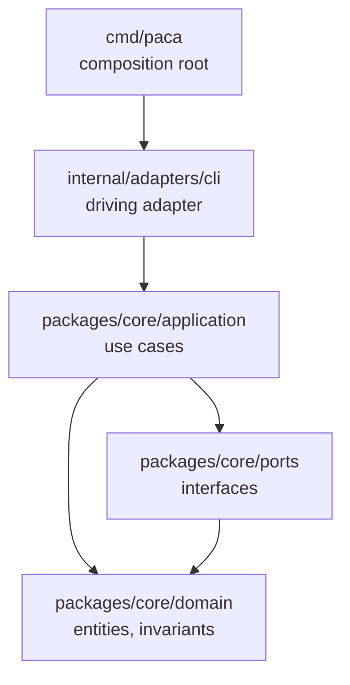

# Backend Scaffold — Go, Hexagonal

**Status:** accepted · **Date:** 2026-10-19 · **Feature:** [`odd/tasks/backend-scaffold.md`](../../odd/tasks/backend-scaffold.md)

The decision record for the PACA backend foundation: the language toolchain, the module
layout, the architecture inside the application, and the quality gate that every change
must pass.

## Context

PACA had a database and no software. The schema shipped in `packages/db`; the
application that will read and write it does not exist yet. The next features —
movement tracking, loan schedules, reports — all need a backend that can grow without
rewriting itself, and a command line application is the first delivery mechanism.

The requirement for this session was scaffolding only: no migration, no feature, a
command header that prints its own help.

## Decisions

### D1 — One Go module per unit, tied together by a workspace

The repository is a monorepo: `apps/` holds runnable applications, `packages/` holds
shared libraries, `tools/` holds repository-wide developer tooling. A Go **workspace**
(`go.work`) keeps those units as real module boundaries while letting them develop
together.

```
paca/
├── go.work            the workspace: apps/cli + packages/core + tools
├── apps/cli/          module github.com/witsaba/paca/apps/cli
├── packages/core/     module github.com/witsaba/paca/packages/core
└── tools/             module github.com/witsaba/paca/tools
```

Rejected: a single module at the repository root. It is simpler, but it erases the
boundary between an application and the libraries it uses, and the repository already
documents `apps/` and `packages/` as units with their own dependencies and release
cadence.

Rejected: a separate repository per unit. The units are not published independently;
the split would cost more than it buys.

**Amendment.** The shared layers were first scaffolded inside `apps/cli/internal/`.
Go's `internal` visibility rule scopes that tree to `apps/cli`, so a second binary
could never import it. They now live in the module `packages/core`, imported by
every delivery mechanism. This is amendment A2 of
[`0001-mcp-agent-server.md`](0001-mcp-agent-server.md).

**Consequence.** Every `go` command that takes a package pattern must run *inside* a
module directory. At the workspace root, `go build ./...` fails with *"directory prefix
. does not contain modules listed in go.work"* — the pattern is resolved relative to the
current module, and the workspace root is not one. The Makefile therefore walks the
modules and runs the command in each.

### D2 — Hexagonal architecture, in four packages

The application follows ports and adapters. The dependency rule is inward only.



| Package | Holds | May import |
| --- | --- | --- |
| `cmd/paca` | the composition root: build the command, run it, exit | the adapter |
| `internal/adapters/cli` | the cobra command tree, flags, help, error presentation | application, ports, domain |
| `packages/core/application` | use cases: orchestrate the domain through the ports | ports, domain |
| `packages/core/ports` | the interfaces of both boundaries | domain |
| `packages/core/domain` | entities, value objects, invariants, domain services | the standard library only |

Each package ships a `doc.go` that states its role and its dependency rule, so the
boundary is written down where it is enforced. The rule that matters most: the domain
never imports an adapter and never touches the database, the clock, the filesystem, or
the network. A rule that lives in the domain must behave the same in the CLI, in a
desktop client, and in a future API.

The layer names follow the Go convention of `cmd/` plus `internal/` described in the
official module layout guidance, with the hexagonal split drawn inside `internal/`.

### D3 — The developer tools are dependencies, not installations

`golangci-lint` and `govulncheck` are declared with the `tool` directive in
`tools/go.mod` and run with `go tool`. Their versions are pinned in `go.mod`/`go.sum`,
so a contributor and a CI run use the same tools, and a contributor needs nothing but
the Go toolchain.

This is the mechanism Go provides for exactly this case: *"Go modules can now track
executable dependencies using `tool` directives in go.mod"*, replacing the older
`tools.go` blank-import workaround.

Rejected: installing the tools globally. The version then depends on the machine, and
"works on my laptop" becomes a real failure mode.

Rejected: pinning the tools in the application module. `golangci-lint` alone pulls
around 150 transitive modules; keeping them in `tools/go.mod` leaves the application
modules free of linter dependencies.

**Consequence.** `go tool govulncheck ./...` inside `tools/` reports vulnerabilities in
the *required modules* of the linter's own dependency tree. They are not reachable
from any PACA code, so the scanner exits `0` and the gate stays green — but the output
must be read, not skimmed.

### D4 — The quality gate

One Makefile at the repository root is the single entry point for the developer
workflow. The targets are the ones the Go project and the wider industry treat as
standard for a service codebase:

| Target | What it runs | Why it is in the gate |
| --- | --- | --- |
| `deps` | `go mod download` per module | reproducible dependency fetch |
| `tidy` | `go mod tidy` per module | keeps `go.mod` honest |
| `build` | `go build ./...` per module, binaries into `bin/` | it compiles, and the binary is runnable |
| `test` | `go test ./...` per module | the suite passes |
| `cover` | `go test -covermode=atomic -coverprofile` + `go tool cover -func` | the coverage of the change is known |
| `race` | `go test -race ./...` per module | data races are reported, not guessed |
| `vuln` | `govulncheck ./...` per module | known vulnerabilities in reachable code are caught |
| `vet` | `go vet ./...` per module | the toolchain's own analyzers, with no third-party tool involved |
| `lint` | `golangci-lint run` per module | the standard linter set plus the checks that matter |
| `fmt` / `fmt-check` | `gofmt` | one formatting, enforced |
| `all` | fmt-check, vet, lint, build, test, race, vuln | the whole gate, in the order that fails fastest |
| `run` | `go run ./cmd/paca` | the application, without installing it |
| `clean` | removes `bin/`, `coverage.out`, `.coverage/` | a clean tree |

`all` is what CI runs. The order is deliberate: formatting and linting fail in
seconds, before the slower build, test, race and vulnerability steps.

**Why `vet` is a separate target when the linter already runs the govet checks.**
It is not a second opinion on the same rules: `golangci-lint` enables `govet` in its
standard set, and `go test` runs a vet subset on its own. The target is worth its
place for three other reasons:

- it is the check that needs **nothing but the Go toolchain** — no third-party tool
  to download, build, or keep at a matching version, so it cannot fail because the
  linter cannot be installed;
- it is the **cheapest real check** in the gate (about half a second per module
  against several seconds for the linter), which is why it runs before the linter;
- the analysis comes from the **Go version pinned in `go.work`**, not from a linter
  configuration that can exclude rules.

A developer who wants one command gets `make all`; a developer who wants a fast
signal on a change gets `make vet` alone.

### D5 — cobra for the command line

The command header is built with `github.com/spf13/cobra`, the de facto standard for Go
command line applications. It provides the `--help` output, the flag parsing a finance
CLI will need, and the command tree that the future subcommands attach to.

Rejected: `urfave/cli` — capable, but the less common choice, and the migration cost
of switching later is real.
Rejected: the standard library `flag` package — no command tree, no subcommand help,
and a help output that does not read like a product.

## Consequences and known limits

- **The composition root is not covered by the test suite.** `cmd/paca` holds `main`,
  which is not reachable from a test without executing the binary. The behaviour it
  wires is tested at the adapter level, where the command is built and executed with
  arguments. Coverage therefore reports `0.0%` for `cmd/paca`; that number is expected,
  not a gap to close.
- **Lint and vulnerability scans run per module**, not from the repository root, for the
  reason given in D1. The Makefile hides this; a contributor running the tools by hand
  must run them inside a module.
- **The `tools` module is a real module with a single package** whose only content is
  its documentation. It exists so that the tool pinning has a home and the workspace
  targets have something to walk.
- **The vulnerability scanner's "modules you require" count is high** (the linter's
  dependency tree). Only the "your code is affected by" count is the gate.

## Sources

- [Organizing a Go module](https://go.dev/doc/modules/layout) — the `cmd/` and
  `internal/` convention, and why `internal` exists.
- [Managing dependencies: tool dependencies](https://go.dev/doc/modules/managing-dependencies#tool-dependencies)
  — the `tool` directive, `go get -tool`, and `go tool`.
- [Go 1.24 release notes](https://go.dev/doc/go1.24#tools) — tool directives replace the
  `tools.go` blank-import workaround.
- [Get familiar with Go workspaces](https://go.dev/blog/get-familiar-with-workspaces)
  and [multi-module workspaces](https://go.dev/doc/tutorial/workspaces) — how a workspace
  resolves a package pattern.
- [golangci-lint documentation](https://golangci-lint.run/docs/) — the linter, its
  v2 configuration, and the [formatters](https://golangci-lint.run/docs/formatters)
  (`gofmt`, `goimports`).
- [cobra on pkg.go.dev](https://pkg.go.dev/github.com/spf13/cobra) — the command tree,
  the help template, and the default completion and help commands.
